  

### Hi, I'm Arda.

I'm a computer engineer from Eskişehir, and I'm happiest where software meets hardware. On a microcontroller, that means C written straight from the reference manual, with no HAL in between. On a Raspberry Pi or a Jetson, it means C++ processes talking over sockets while sensors stream data in. When that data needs a model, I switch to Python and PyTorch.

A lot of this work ends up with the same job: **noticing when something is off.** A key that bounces, a turbine that starts to vibrate differently, a crack in a wooden board, a leaf getting sick before it looks sick. When nothing needs fixing, I write C++ simulations, mostly because it's fun to watch sand pile up.

I finished my B.Sc. in Computer Engineering in 2026 with a 3.83 GPA, ranked first in both my department and my faculty.

<table>
<tr>
<td width="50%" valign="top">

<b><a href="https://github.com/ardacbk/stm32f411ceux_driver">stm32f411ceux_driver</a></b> · C · ARM Cortex-M4 
RCC, GPIO, SysTick and EXTI/NVIC drivers for the STM32F411 "Black Pill", written from the reference manual without HAL or LL. A 4×4 keypad BSP sits on top of the GPIO driver and debounces keys with a non-blocking state machine timed by SysTick. Builds with CMake, Ninja and arm-none-eabi-gcc.

</td>
<td width="50%" valign="top">

<b><a href="https://github.com/ardacbk/raspi-remote-control-system">raspi-remote-control-system</a></b> · C++17 · Linux 
Four processes split across a PC and a Raspberry Pi 3. The PC client talks TCP to a router process, which hands each command to the process that owns the hardware. One drives a sensor, a relay and a 4×4 keypad over GPIO with libgpiod. The other answers temperature and humidity queries from a UART thread on <code>/dev/serial0</code>.

</td>
</tr>
<tr>
<td width="50%" valign="top">

<b>Graduation project</b> · NVIDIA Jetson · PyTorch 
A Jetson reads 28 vibration channels and turns them into 426-dimensional FFT features and spectrograms. LSTM autoencoders flag the moments when the machine stops sounding like itself, and a CNN reads the spectrograms. The data streams over MQTT (TLS, MessagePack) into TimescaleDB.

</td>
<td width="50%" valign="top">

<b><a href="https://github.com/ardacbk/sand-simulation">sand-simulation</a></b> · C++ · SFML 
A falling-sand cellular automaton. Every cell holds an <code>Element</code>, and Sand, Water and Stone each implement their own <code>update()</code>. Sand falls, slides diagonally and sinks through water. Water flows down, then sideways. Stone stays put. Left click pours sand and right click pours water. The animation runs the same rules.

</td>
</tr>
<tr>
<td width="50%" valign="top">

<b>ASELSAN internship</b> · 2025 
During my internship in Microelectronics and Electro-Optical Systems, I modeled a 3D-plane alignment task as a Gymnasium environment and trained an agent to do the alignment on its own.

</td>
<td width="50%" valign="top">

<b><a href="https://github.com/ardacbk/wood_anomaly_detection">wood_anomaly_detection</a></b> 
Three pretrained anomaly detectors, GLASS, EfficientAD and INP-Former, run on images of wooden boards. A Flask backend and a React frontend show their anomaly maps side by side.

</td>
</tr>
<tr>
<td width="50%" valign="top">

<b>TÜBİTAK-funded research</b> · 2024 – 2025 
I worked on AI models that catch plant diseases early, using both leaf images and sensor data. I also built the research group's website with Spring Boot.

</td>
<td width="50%" valign="top">

<b><a href="https://github.com/ardacbk/NAIM-CKD">NAIM-CKD</a></b> 
I applied NAIM, a transformer that handles missing values directly instead of filling them in, to the UCI Chronic Kidney Disease dataset. I then compared it with SVM, KNN and Random Forest trained on median/mode-imputed data.

</td>
</tr>
</table>

### Along the way

| When | Where | What I did |
| --- | --- | --- |
| 2026 | **Alp Havacılık** · IT intern | A C# desktop app that computes start and end times for jobs and schedules them across available resources, built on SQL Server with a WinForms/WPF interface |
| 2025 | **ASELSAN** · summer intern | The RL plane-alignment agent shown in the projects |
| 2024 – 25 | **TÜBİTAK** · volunteer researcher | Plant disease detection from images and sensor data |
| 2024 – 25 | **TÜSEB** · scholarship researcher | A Unity VR simulation that teaches elderly people how to use an ATM |
| 2022 – 26 | **Eskişehir Osmangazi University** | B.Sc. Computer Engineering · GPA 3.83 / 4.00 · ranked 1st in the department and the faculty |

### Toolbox

| Close to the hardware | Signals & models |
| --- | --- |
| C · C++17 · STL · POSIX threads | Python · NumPy · pandas |
| STM32 / ARM Cortex-M4 · CMSIS · register-level drivers | PyTorch · TensorFlow · scikit-learn |
| GPIO · EXTI/NVIC · SysTick · UART · libgpiod | CNNs · LSTM autoencoders · RL (Gymnasium) |
| Raspberry Pi · NVIDIA Jetson · Linux | FFT · spectrograms · anomaly detection |
| TCP/IP sockets · MQTT (TLS) · MessagePack | TimescaleDB · PostgreSQL · SQL Server |
| CMake · Ninja · arm-none-eabi-gcc · Visual Studio | LLM APIs · embeddings · RAG |

I also use C#, Java, Spring Boot, React, .NET, Unity, Docker and SFML. I speak Turkish natively, and my English is C1 (YDS 85/100).

### More C++

- [`RayTracing`](https://github.com/ardacbk/RayTracing): a ray tracer with emissive materials and progressive accumulation, built on Walnut along The Cherno's series
- [`particle-physics-simulation`](https://github.com/ardacbk/particle-physics-simulation): Verlet-integration particles with gravity, collisions and a boundary constraint, drawn with SFML
- [`water-sorting-game`](https://github.com/ardacbk/water-sorting-game): the water-sort puzzle
- [`leetcode-solutions`](https://github.com/ardacbk/leetcode-solutions): LeetCode solutions

Outside C++, there's [`tcdd-empty-seat-finder`](https://github.com/ardacbk/tcdd-empty-seat-finder), a Spring Boot API for anyone who has refreshed the TCDD ticket page one too many times.

### Say hello

I'm looking for roles in **embedded software** and **machine learning**. You can reach me on
[LinkedIn](https://www.linkedin.com/in/arda-%C3%A7abuk-8355b2253), by email at
[ardacabuk1@hotmail.com](mailto:ardacabuk1@hotmail.com), or on
[LeetCode](https://leetcode.com/u/prathos/).

Every animation on this page is a plain SVG, generated by the scripts in <a href="assets/src">assets/src</a>.

